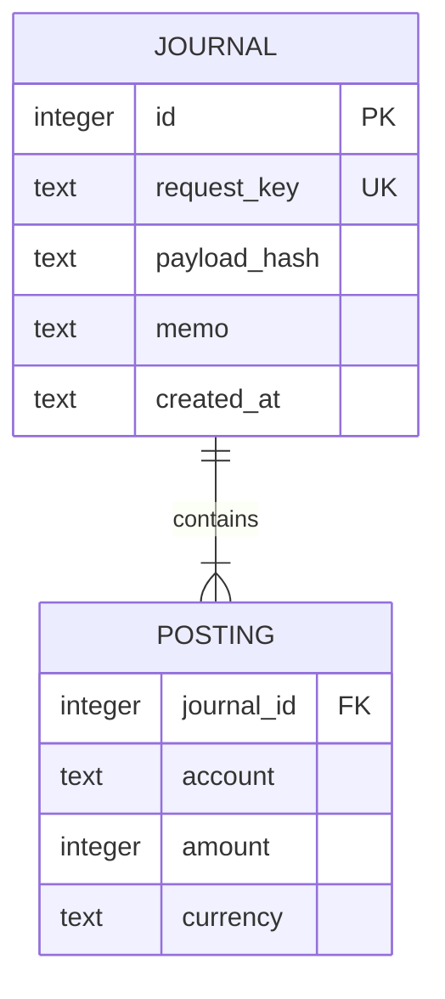

# Journal

**An inspectable double-entry journal with safe retries.**

If a caller retries a successful payment after a timeout, the journal must not post it twice. If the same retry key is reused for a different payment, silently accepting it is just as bad. Journal handles both cases inside a SQLite transaction.

## Try it

Run from the repository root:

```sh
python -m projects.ledger.core --db demo.db post projects/ledger/examples/sale.json
python -m projects.ledger.core --db demo.db post projects/ledger/examples/sale.json
python -m projects.ledger.core --db demo.db balances
python -m projects.ledger.core --db demo.db reverse 1 --key undo-demo-sale
python -m projects.ledger.core --db demo.db balances
```

The first two calls both return journal ID 1 on a fresh database. Balances are 125000 and -125000 minor units. The reversal adds a second journal and brings both balances to zero.

## Data model



Positive amounts are debits, negative amounts are credits. Amounts are integer minor units; the journal does not infer a currency's decimal exponent.

## Guarantees through the application

- At least two nonzero entries; each currency balances independently.
- Float and boolean amounts are rejected.
- Posting is atomic: journal and entries commit together.
- An identical key and canonical payload return the original journal ID.
- Reusing a key for changed content raises an error.
- Entry order does not change the canonical payload.
- Updates and deletes are blocked by triggers. Corrections use new offsetting entries.

`BEGIN IMMEDIATE` obtains the SQLite write reservation before checking the key. Concurrent calls cannot both pass a missing-key check and independently insert. The database also enforces uniqueness.

## Tests

```sh
python -m unittest discover -s tests -p 'test_ledger.py' -v
```

The tests exercise 24 concurrent retries, conflicting retries, cross-currency imbalance, invalid amounts, reversals, and direct update/delete attempts.

## Boundaries

This is a local backend component, not a banking service. No HTTP authentication, account permissions, migration system, or account master exists. Database owners can remove triggers, insert postings directly, or replace the file; append-only triggers are not tamper-proof storage. Balance enforcement belongs to the posting API, not a deferred database constraint.

Reversal retries require the same reversal key. A different key creates another offsetting entry; preventing multiple business reversals would need a separate reversal relation and uniqueness rule.

SQLite serializes writers and waits up to ten seconds. Use a file path, not `:memory:`, because operations open separate connections. Individual postings are bounded to 10^15 minor units; accumulated balances must remain within SQLite's signed 64-bit integer range.
